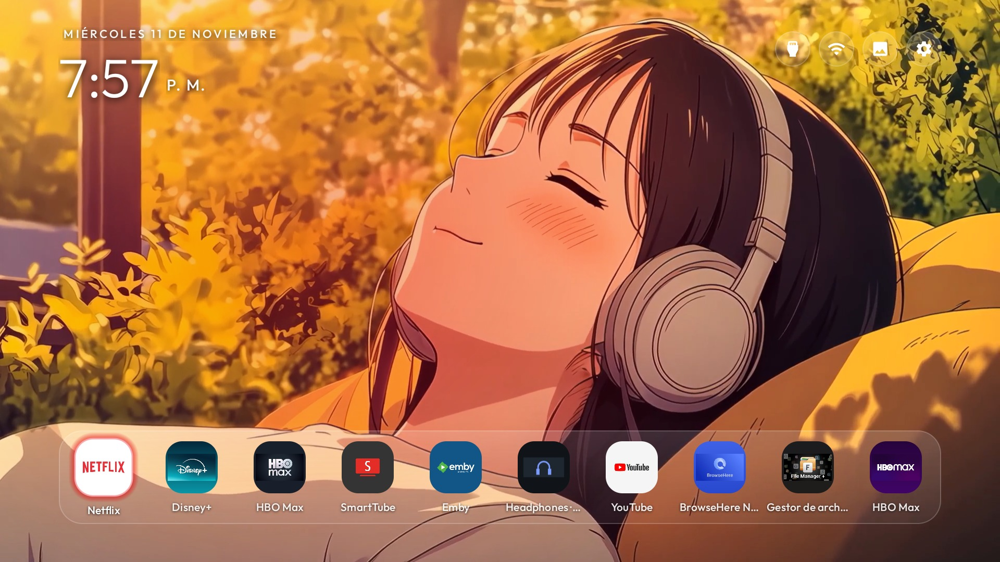
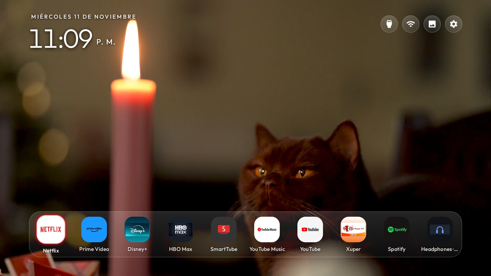
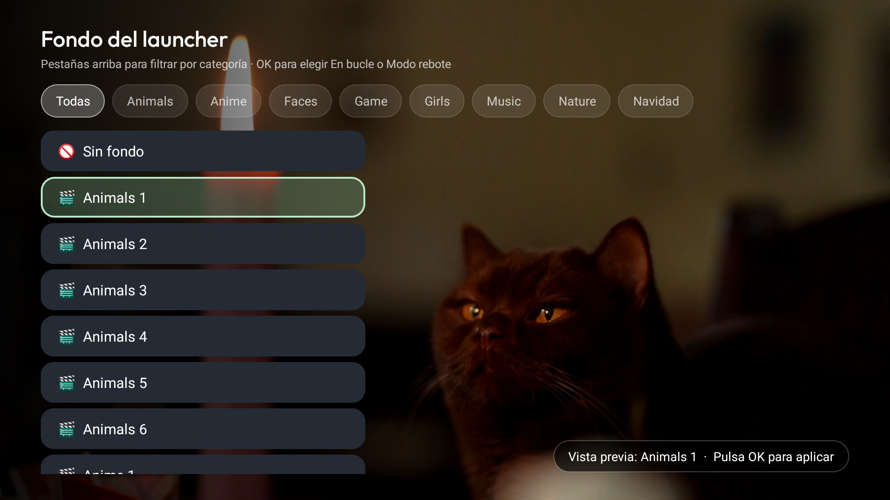
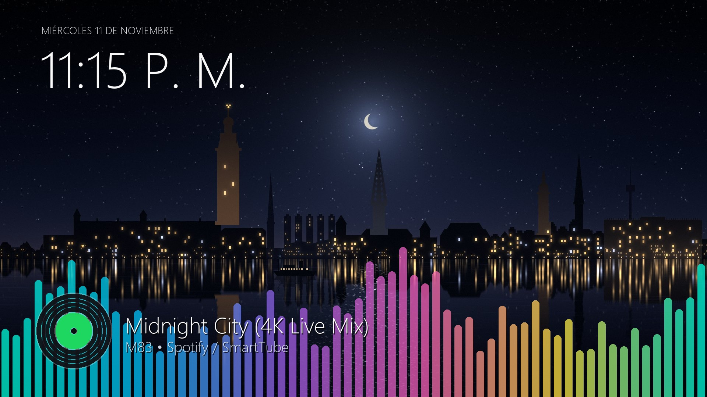

# CleanYourTV Wallpaper 4K Live

Una adaptación del launcher [CleanYourTV](https://github.com/Gathin23/cleanyourtv) enfocada en **fondos animados y salvapantallas en video 4K** con decodificación nativa por hardware, visualizador de audio en tiempo real y controles multimedia integrados para Android TV / Google TV.

---

> [!CAUTION]
> ### ⚠️ EXCLUSIVO PARA TELEVISORES 4K
> Esta edición está optimizada y diseñada **exclusivamente para TVs 4K** con chip de decodificación de video fluido por hardware.
> Si tu televisor es 1080p / 720p o de recursos muy ajustados (1 GB RAM), durante la instalación puedes elegir la **Opción 2: CleanYourTV Original**.

---

## 📸 Capturas de Pantalla en TV Real

| Home Animado 4K (Anime) | Home Animado 4K (Animals) |
|---|---|
|  |  |

| Selector de Fondos por Categoría | Salvapantallas Musical con Vinilo y Espectro RGB |
|---|---|
|  |  |

---

## ✨ Características Principales

- **Fondos y Salvapantallas en Video 4K:** Categorizados en `Animals`, `Anime`, `Faces`, `Game`, `Girls`, `Music`, `Nature` y `Navidad`.
- **Visualizador de Espectro de Audio RGB a 60 FPS:** Visualizador FFT nativo de bajo consumo (`android.media.audiofx.Visualizer` sesión 0) en el Home y en el Salvapantallas.
- **Salvapantallas Musical Inteligente:** Cuando hay música sonando, el salvapantallas entra automáticamente en la categoría `Music`, alternando videos cada **15 segundos** con transiciones cinematográficas.
- **Vinilo Giratorio con Portada y Metadatos:** Disco de vinilo animado en la esquina inferior izquierda con la carátula oficial de la pista (o ícono de la app como respaldo), título y artista.
- **Controles Multimedia y Botón Dormir:** Controles bajo el reloj visibles únicamente al reproducir y botón rápido para activar el salvapantallas en la barra superior.
- **Optimizado para Música y Streaming:** 
  - Compatibilidad total con **Spotify** y **YouTube**.
  - Si no tienes suscripción Premium, recomendamos ampliamente utilizar [SmartTube](https://github.com/yuliskov/SmartTube) (cliente de YouTube sin publicidad y con soporte multimedia en segundo plano).

---

## 🎬 Fondos de Pantalla y Videos

Los videos no se suben directamente al repositorio de GitHub para mantener el código ligero.

### 📥 Descarga del Pack de Fondos (Google Drive)
Puedes descargar la colección completa de fondos de video organizada por carpetas desde este enlace:

👉 **[DESCARGAR PACK DE FONDOS 4K AQUÍ (GOOGLE DRIVE)]** *(Pega tu enlace de Google Drive aquí)*

### 📁 Cómo agregar tus propios videos o usar el pack descargado
Si deseas agregar tus propios videos o cargarlos al televisor:

1. Coloca tus videos en formato `.mp4` dentro de la carpeta `wallpaper/` en tu computadora, organizados en sus subcarpetas correspondientes:
   ```text
   wallpaper/
   ├── Animals/
   ├── Anime/
   ├── Faces/
   ├── Game/
   ├── Girls/
   ├── Music/
   ├── Nature/
   └── Navidad/
   ```
2. Puedes descargar cualquier video en bucle o fondo animado (resolución 4K o 1080p en formato MP4 H.264/H.265).
3. Transfiere los videos automáticamente a la TV con el siguiente comando:

**En Windows (PowerShell):**
```powershell
powershell -ExecutionPolicy Bypass -File tools\push-videos.ps1 -TvHost <IP_DE_TU_TV> -Folder ".\wallpaper"
```

**En Linux / macOS:**
```bash
TV_HOST=<IP_DE_TU_TV> ./tools/push-videos.sh "./wallpaper"
```

Los videos se alojan en tu televisor en la ruta interna:
`/sdcard/Android/data/com.gathin.tvhome/files/media/<Categoria>/`

---

## 🚀 Guía de Instalación Rápida

### 1. Activar Depuración en la TV
En tu Android TV / Google TV: **Ajustes** → **Preferencias del dispositivo** → **Información** → pulsa **OK 7 veces** en **Compilación** para activar las Opciones de Desarrollador. Entra en ellas y activa **Depuración por USB** (y red/inalámbrica si existe).

### 2. Clonar y Preparar Entorno
```powershell
git clone https://github.com/Fgarache/cleanyourtv-4k-pro.git
cd cleanyourtv-4k-pro
python -m venv tools\venv
tools\venv\Scripts\python.exe -m pip install -r tools\requirements.txt
```

### 3. Instalar el Launcher (Selector de 2 Versiones)
Al ejecutar el script de instalación, te preguntará cuál launcher deseas:

- **[1] Launcher Custom 4K Pro Edition (Recomendado para TV 4K)**
- **[2] CleanYourTV Original (Clásico y ligero)**

```powershell
powershell -ExecutionPolicy Bypass -File launcher\build-and-install.ps1 -TvHost <IP_DE_TU_TV>
```

---

## 🔗 Referencias y Créditos

- **Proyecto Base:** [CleanYourTV](https://github.com/Gathin23/cleanyourtv) por [@Gathin23](https://github.com/Gathin23).
- **Cliente YouTube Recomendado:** [SmartTube](https://github.com/yuliskov/SmartTube) por [@yuliskov](https://github.com/yuliskov).
